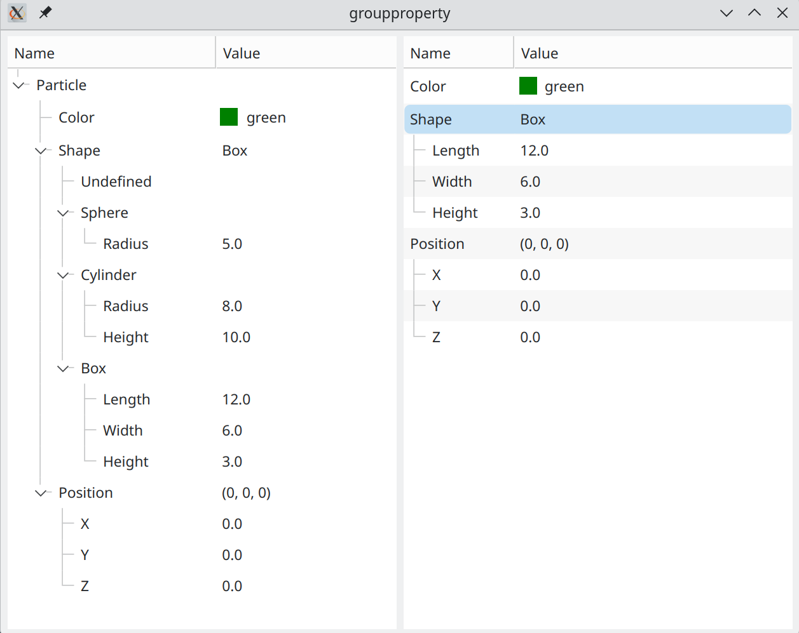

# Example "groupproperty"

Demonstrates the group property: a property holding a set of predefined items with only one of them
being current at a time.

Consider the parametrization of a nano-particle for a later simulation of x-ray scattering. Our
nano-particle has a color, a shape, and `(x,y,z)` coordinates in space. For the shape we want to
offer the user a choice: the particle can be spherical, cylindrical, or a box. Each shape has its own
set of parameters (`Radius` for a sphere, `(Length,Width,Height)` for a box, etc.).

The application model contains a single `ParticleItem` with three properties:

- a color property,
- a `ShapeGroupItem` property for the shape selection,
- a `VectorItem` property for the position.

The same `ParticleItem` is shown in two editors. The ordinary tree on the left represents the whole
content of the model. The property editor on the right shows the content of the `ParticleItem`, where
the unused shapes and their parameters are hidden. Switching the current shape in the combo box
regenerates the parameters shown beneath the group.

